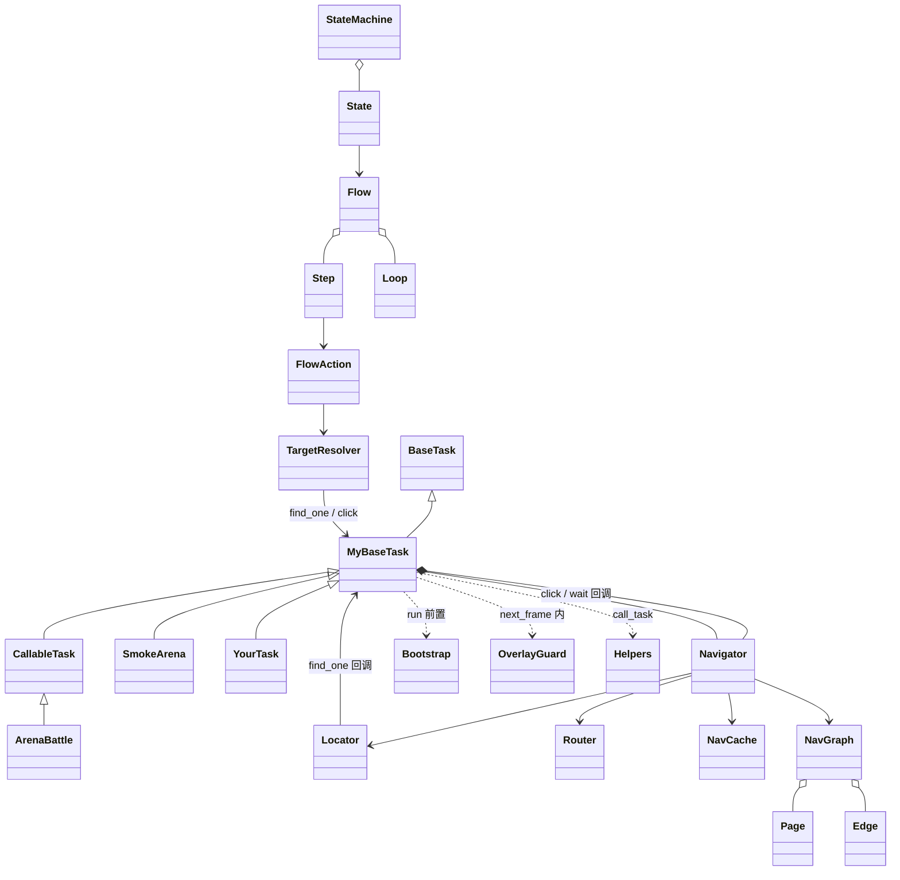

# 类图与分层关系

本页用图说明 `ok-script` 基类、我们的框架层（导航 / 编排 / 运行时）与业务任务之间的关系。
`<|--` 继承，`*--` 组合，`-->` 依赖，`..>` 弱依赖。

## 1. 总览（文本版，任何渲染器都能看）

```
                        ┌──────────────────────────────────────────┐
                        │ GUI / CLI / MCP（入口层）                  │
                        └───────────────┬──────────────────────────┘
                                        │ 触发 run()
┌───────────────────────────────────────▼──────────────────────────────────────┐
│ ok-script（第三方，不改）                                                       │
│  BaseTask: run() / find_one() / click() / wait_until() / ocr() / screenshot()  │
│  TaskExecutor: next_frame() / wait_condition()                                 │
│  FeatureSet: find_feature()（真正的模板匹配，cv2.matchTemplate）                 │
└───────────────────────────────────────┬──────────────────────────────────────┘
                                        │ 继承
┌───────────────────────────────────────▼──────────────────────────────────────┐
│ 我们的基类层                                                                    │
│  MyBaseTask                                                                   │
│    ├─ 启动层：ensure_game_ready()  → Bootstrap.ensure_ready()                  │
│    ├─ 弹窗层：next_frame() 内挂 OverlayGuard                                   │
│    ├─ 导航层：goto() / ensure_page() / nav_back() / on_page()                  │
│    ├─ 匹配壳：覆写 find_one()（可选低阈值兜底）                                 │
│    └─ 调用：call_task(target, **kw) → Helpers.resolve()                        │
│  CallableTask（继承 MyBaseTask）：execute(**kw) / result                        │
└───────────────────────────────────────┬──────────────────────────────────────┘
                                        │ 继承
┌───────────────────────────────────────▼──────────────────────────────────────┐
│ 业务任务（开发者写）                                                            │
│  ArenaBattle(CallableTask) · SmokeArena(MyBaseTask) · YourTask(MyBaseTask)     │
└──────────────────────────────────────────────────────────────────────────────┘

并列的被组合对象（都不是 Task，不能被调度）：

  MyBaseTask *── Navigator ──> Locator ──> NavGraph ──> Page / Edge
                    │            └─ 回调 find_one
                    ├──> Router（BFS/Dijkstra 寻路）
                    ├──> NavCache（configs/nav_cache.json）
                    └──> ActionExecutor（click_point / key / click_template）

  Flow / StateMachine / Loop        （编排层，只持数据与逻辑）
    Flow o── Step ; Flow o── Loop ; StateMachine o── State ; State --> Flow
    Step --> FlowAction（Click / LongPress / Swipe / InputText …）
    FlowAction --> TargetResolver（模板名 / 坐标 / 框 / lambda）
    TargetResolver --> MyBaseTask.find_one / click
```

## 2. Mermaid 版（支持 Mermaid 的渲染器可直接显示）



## 3. 关系表

| 从 | 到 | 关系 | 说明 |
| --- | --- | --- | --- |
| `MyBaseTask` | `BaseTask` | 继承 | 只加能力，不改 ok-script |
| `CallableTask` | `MyBaseTask` | 继承 | 增加 `execute()` 契约与 `result` |
| 业务任务 | `MyBaseTask` / `CallableTask` | 继承 | 只有它们能被 GUI/CLI/MCP 调度 |
| `MyBaseTask` | `Navigator` | 组合 | 在 `locator`/`navigator` 属性里按需创建 |
| `Navigator` | `Locator` / `Router` / `NavCache` | 依赖 | 定位、寻路、记录跳转 |
| `Navigator` | `MyBaseTask` | 回调依赖 | 通过注入的 `find` / `click` / `wait_page` |
| `Flow` | `Step` / `Loop` | 组合 | 顺序执行；`Stop` 用于提前终止 |
| `StateMachine` | `State` | 组合 | 守卫分支；`State.do` 可为 `Flow` |
| `Step` | `FlowAction` | 组合 | `click=` 等语法糖会构造成对应动作 |
| `FlowAction` | `TargetResolver` | 依赖 | 模板名 / 归一化坐标 / 框 / lambda |
| `TargetResolver` | `MyBaseTask` | 依赖 | 最终调用 `find_one` 与点击方法 |

## 4. 三条判断规则

1. **有 `run()` / `build_flow()` 的才是 Task**，只有 Task 能被调度；导航与编排都是「能力」。
2. **导航、编排都不继承 `BaseTask`**，因此可以离线单测（`tests/test_nav.py`、`tests/test_flow.py` 用替身）。
3. **所有匹配都汇到 `task.find_one`**（动作、`wait`、导航锚点、导航按钮），因此「统一匹配壳」只需要覆写这一个方法。
