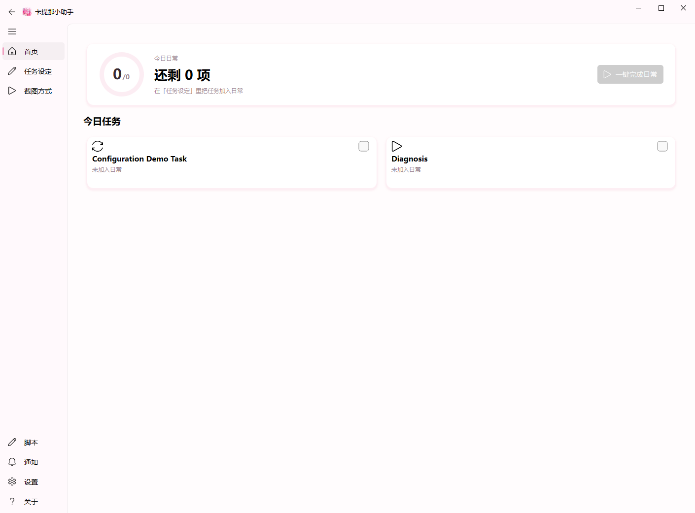
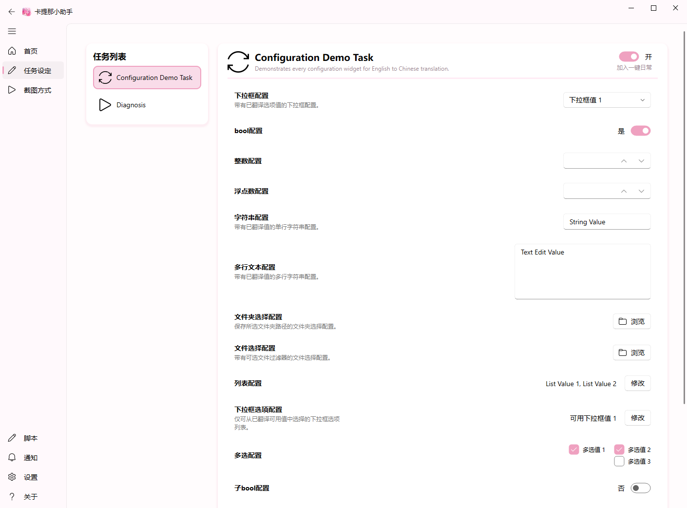
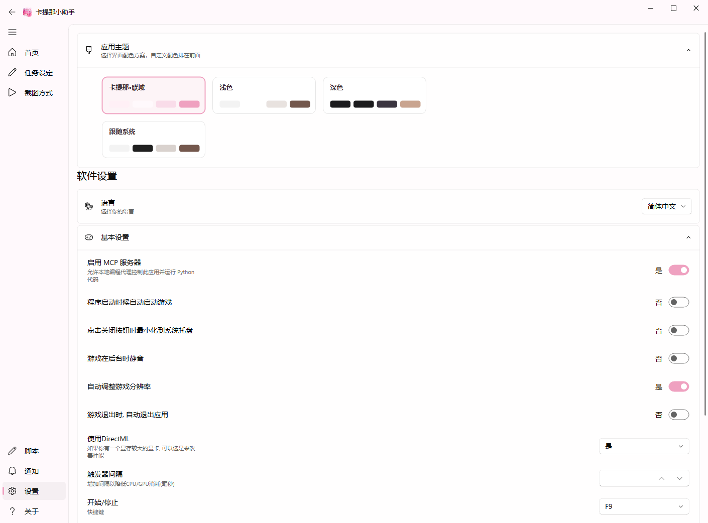
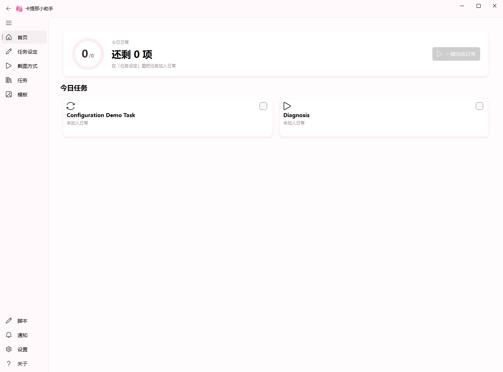
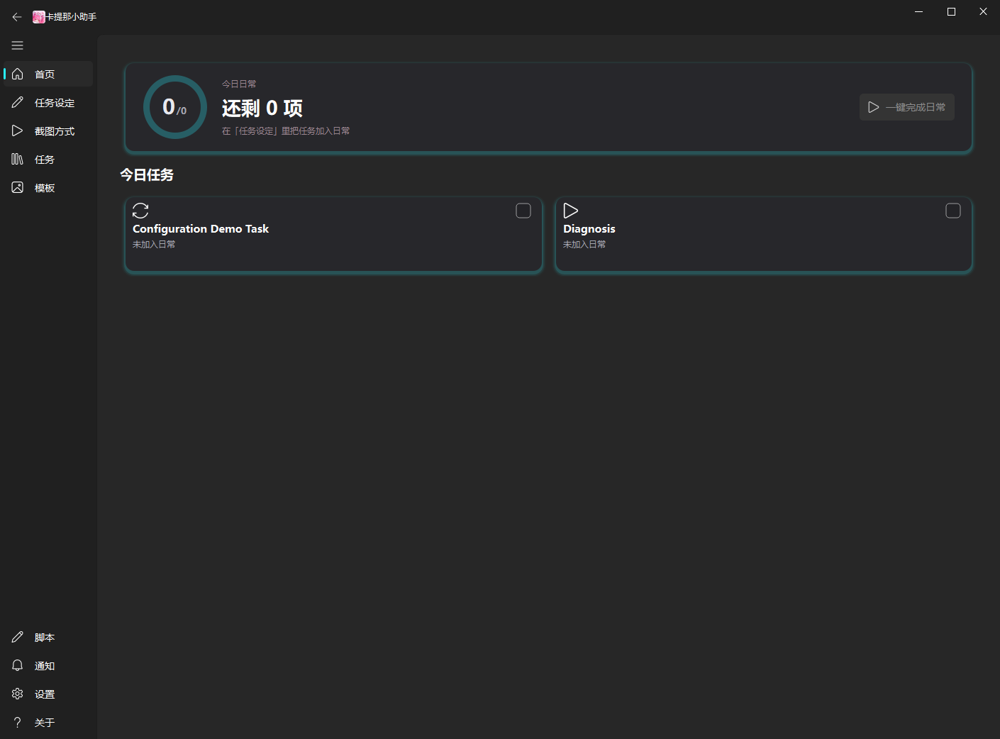

# 界面总览

本项目在 ok-script 原生界面之上增加了两个自定义页面：**首页** 和 **任务设定**。
两者通过 `src/config.py` 的 `custom_tabs` 注册，不修改 ok-script 自身的界面代码。

## 名称与图标

- 窗口标题：`src/config.py` 的 `gui_title`（当前为「卡提那小助手」），
  启动后由首页把标题精简成纯应用名，去掉版本号与 profile 后缀。
- 窗口/任务栏/tray 图标：`icons/icon.png`（由 `gui_icon` 指定），
  打包时同一张图也会作为 exe 图标来源。原来的占位图备份在 `icons/icon.orig.png`。

## 启动

```bat
:: 普通用户：带 MCP 服务的图形界面
.\.venv\Scripts\python.exe -m ok gui --mcp --config src.config:config

:: 只开图形界面
.\.venv\Scripts\python.exe main.py
```

同一时刻只允许一个 ok-script 进程运行，启动前请先关闭已有实例。

## 首页



- 顶部一张横向卡片：左侧是环形进度（已完成 / 总数，紫色弧线走完即全部完成），
  中间是「今日日常」小标题 + 大字「还剩 N 项」+ 提示，右侧是 **一键完成日常** 按钮。
  没有待完成项时按钮自动禁用。
- 下方「今日任务」区域用固定尺寸的圆角小卡片排成紧凑网格（窗口变宽会自动多排几张）：
  - 左上角任务图标，右上角「加入一键日常」勾选框；
  - 中间是任务名称（过长自动省略，悬停看全名）；
  - 底部一行是今日状态：`今日已完成` / `待完成` / `未加入日常`。
- 点「一键完成日常」会按顺序执行所有勾选任务；每完成一个，统计数字立即减一。
- 鼠标移到卡片上会变成小手、底色淡入到主题的 hover 色（140ms 过渡）；点击卡片会跳到
  **任务设定** 页并自动选中这个任务。
- 卡片高度固定 104px、宽度随窗口在 100px 以上伸缩，卡片间距固定 20px，
  卡片区与上方大卡片的左右边缘始终对齐：窗口变宽时卡片一起变宽，
  宽度收到 100px 下限后会多排一行。
  窗口最小宽度受 ok-script 内置「截图方式」页限制（约 1200px），再窄的验证可以临时把
  `src/config.py` 里的 `gui.window_size.min_width` 与内置页一起调小。

> 首页和任务设定页都是**自动收集**任务：只要任务在 `src/config.py` 的 `onetime_tasks` 里注册
> （或放进 `ok_tasks/` 目录），就会自动出现在这两个页面，不需要改 GUI 代码。

## 任务设定



- 左侧竖卡片是任务列表，显示每个任务的图标和名称，点击即切换。
- 右侧卡片是纯静态布局，与左侧列表顶端对齐，切换任务时直接显示、没有展开动画：
  - 顶部 title 区：图标、任务名称、任务描述，最右侧是 **加入一键日常** 开关，
    与首页卡片上的复选框是同一份状态；
  - 下方按 `default_config` 自动生成文本框、数值框、下拉框、开关等控件，
    修改后立即写入 `configs/<任务类名>.json`；
  - 底部「恢复默认」把所有配置项还原成默认值。

## 界面裁剪

`src/ui/shell_patch.py` 在主窗口显示后做两件事，都是**只隐藏、不删除**：

- **语言**：设置页的语言下拉只保留「简体中文」。其它语言项从下拉列表里摘走，
  原对象挂在 `ComboBox._hidden_items` 上；`ok` 的 `Language` 配置项本身没有改动，
  以后要放开更多语言，把这里的隐藏逻辑去掉即可。
- **导航**：「任务」「模板」两页不再出现在左侧侧边栏（`onetime_tab`、`template_tab`
  高度设为 0）。页面对象和路由都还在，需要时仍可用 `window.switchTo(...)` 打开。

## 视觉风格

- 所有卡片（统计卡、任务小卡、任务列表容器、任务详情卡）统一为 12px 圆角、无描边、
  白色背景 + 一层很薄的投影：卡片在四周预留 8px 空白，`paintEvent` 里用三层圆角矩形
  （向外扩 2/4/6px、整体下移 3px、透明度递减）自绘，颜色取当前主题色，
  深色主题下自动加深。不用 `QGraphicsDropShadowEffect` 是因为父控件会把阴影裁掉，
  导致卡片四角出现小三角。
- 任务列表里的每一行不带独立投影，只在悬停时浅底、选中时浅紫底 + 主题色描边，
  避免列表出现「一层层浮起来」的杂乱感。
- 环形进度是自绘控件（`src/ui/cards.py` 的 `RingProgress`），
  底色轨道 + 主题色圆弧 + 中心「已完成 / 总数」，颜色同样跟随主题。
- 页面左右内边距 40px（`PAGE_PADDING`），所有内容区控件的左右边缘都对齐这条线。

## 主题

设置页第一项「应用主题」现在是一排长方形配色卡片：**自定义配色在前，浅色 / 深色 / 跟随系统排在最后**。
点卡片立即生效，选择保存在 `configs/UiTheme.json`，下次启动自动恢复。

| 配色 | 侧边栏 & 标题栏 | 内容区底色 | hover | 选中 | 控件色 |
| --- | --- | --- | --- | --- | --- |
| 卡提那·联域 | `#FFF0F6` | `#FFF9FC` | `#FFF0F6` | `#F9DCE9` | `#EFA1C0` |

三套内置配色（浅色 / 深色 / 跟随系统）保持 ok-script 原生外观：底色、侧边栏、标题栏
全部由主题模式决定，控件色统一取 qfluentwidgets 的主色（默认青蓝 `#009faa`），
环形进度、开关、按钮、勾选框因此永远同色。





深色主题下侧边栏、标题栏与内容区都会变深，控件色统一：



### 实现方式

- `src/ui/theme.py` 里的 `Palette` 是一个 `dataclass`，**字段就是「部位」**：
  `sidebar_bg / titlebar_bg / page_bg / card_bg / hover_bg / selected_bg / accent / text / subtext / border / shadow`。
  以后做「用户自定义各部位颜色」时，改的就是这些字段。
- `CUSTOM_THEMES` 是主题列表，**加一套主题 = 追加一个 `Palette`**；`BUILTIN_THEMES`
  （浅色 / 深色 / 跟随系统）永远排在列表末尾，仍由 qfluentwidgets 负责。
- 自定义主题的落地方式：把 qfluentwidgets 主色设成 `accent`（这样 switch、按钮、输入框焦点色自动跟随），
  再用一层 QSS 覆盖 `NavigationPanel` 与标题栏底色，窗口背景用 `setCustomBackgroundColor`。
- 组件不写死颜色：`cards.py` 的 `card_bg()` / `card_hover()` / `divider_color()` / `shadow_color()`
  以及 `RingProgress`、`TaskRow` 全部从 `theme.palette()` 取色，切主题时通过 `theme.signals.changed` 重绘。
- 各主题各部位的颜色都写在 `configs/UiTheme.json` 的 `themes` 里（内置主题也会存一份），
  想微调某个部位直接改这个文件即可；`save_colors(key, **colors)` 是给以后「自定义颜色」界面预留的接口。
  自定义值和主题默认值不同时会自动走覆盖层。
- 两个坑：
  1. ok-script 的 `MainWindow` 会在主题变化时把主色同步回 `_configured_theme_color`，
     所以切自定义主题时要连带改这个属性，切回内置主题时再还原，否则会出现「切回浅色但开关还是粉的」。
  2. `MainWindow` 继承的 `FluentWindow` 在 Mica 开启时把窗口背景设成透明，交给系统壁纸绘制；
     系统处于浅色模式时深色主题就会「漏白」。所以内置主题也统一关掉 Mica / 亚克力，
     用实色背景（浅 `#F3F3F3`、深 `#202020`），并且因为主题切换是异步的，用 `_settle_window()`
     轮询校准背景色，直到和当前深浅色一致。

## 状态存放位置

| 文件 | 作用 |
| --- | --- |
| `configs/DailyPlan.json` | 已加入一键日常的任务列表（`selected`） |
| `configs/DailyStatus.json` | 今日已完成的任务与日期（`date`、`done`，跨天自动清空） |
| `configs/DailyPlan.json` / `configs/<任务类名>.json` | 各任务自己的配置值 |
| `configs/_ok.json` | 窗口位置、尺寸、导航栏是否展开 |
| `configs/UiTheme.json` | 当前选中的界面主题 |

需要重置首页进度时，删除 `configs/DailyStatus.json` 后重启即可。

## 实现位置

| 文件 | 内容 |
| --- | --- |
| `src/ui/daily_state.py` | 一键日常的选中/完成状态与信号 |
| `src/ui/cards.py` | 圆角卡片、任务图标等公共控件 |
| `src/ui/home_tab.py` | 首页：统计卡片、任务卡片网格、一键执行线程 |
| `src/ui/task_settings_tab.py` | 任务设定：任务列表 + 静态详情卡片（自动生成配置控件） |
| `src/ui/theme.py` | 主题配色数据（`Palette`）与切换逻辑 |
| `src/ui/theme_settings.py` | 设置页里的主题卡片选择器（替换原生下拉框） |
| `src/ui/shell_patch.py` | 隐藏暂不支持的语言项与「任务 / 模板」导航 |
| `src/config.py` | `custom_tabs` 注册两个页面，窗口默认尺寸 |

## 已知限制

- 任务图标暂时沿用 `BaseTask.icon`，后续可以换成正式素材。
- 数值型配置（如「Launch Timeout (Seconds)」）的输入框在部分环境下不显示当前数字，
  ok-script 自带的「配置演示任务」页面也有同样现象，属于上游渲染问题，不影响保存的值。
